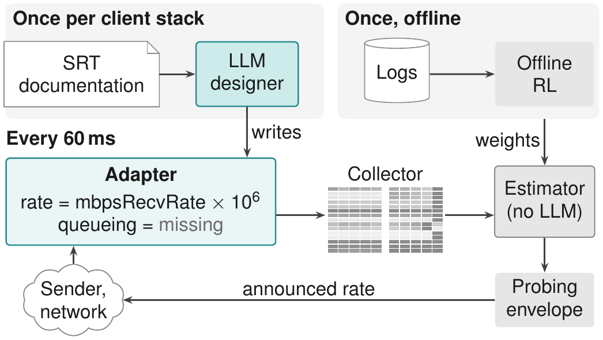
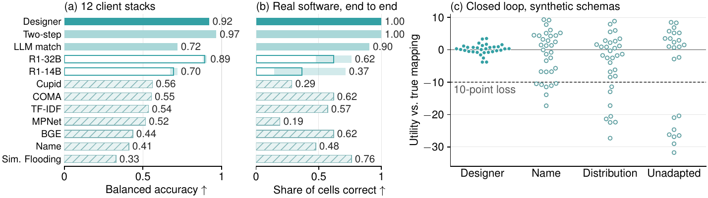
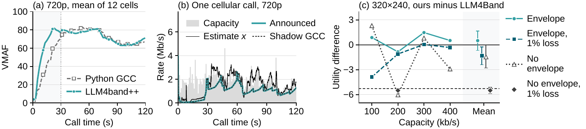

# LLM4band++ reproduction package

Code, data and instructions behind *LLM4band++: Lightweight Bandwidth Estimation with LLM-Designed Telemetry Adapters*
(IEEE Transactions on Multimedia, submitted). From the files here, every table and figure of the paper and its
supplement can be regenerated, and every number in them recomputed from per-call, per-run or per-answer data.

File names and printed labels often differ from the paper's terms; [`docs/GLOSSARY.md`](docs/GLOSSARY.md) defines them.
C-H is the deployed estimator (conference encoder trained with the HCQ reward, no LLM), `arm_ch_x` is that estimator
in the testbed, and `llm4bandpp` or "LLM4band++ (Qwen)" in file names is the paper's one-token LLM variant, not the
deployed system.

<p align="center"></p>

*Fig. 1. Once per client stack, the LLM designer reads the telemetry documentation and writes an adapter (shown: its
output for the SRT library), which code runs every 60 ms to fill the estimator's 15 features or mark them missing. The
estimator, trained offline, runs without an LLM behind a probing envelope.*

## Results at a glance

| Result | Paper |
|---|---|
| The deployed estimator has a macro MSE of 5.80 on the 870 validation calls, 16.3% below LLM4Band (95% interval 13.4% to 19.4%). | Table I |
| It decides in 0.07 ms on a laptop CPU with 0.68 M parameters. An LLM in the per-step path costs at least 39 ms per decision and adds no detectable accuracy. | Tables II, III |
| Asked for units and counting rules, the LLM designer reaches a balanced accuracy of 0.92 on 12 held-out client stacks, against 0.56 for the best non-LLM matcher (Cupid) and 0.72 for the same LLM used as a generic matcher. | Fig. 3(a), Table IV |
| At 720p the deployed system has higher VMAF than a Python GCC in every batch, by 4.3 to 8.9 on average; most of the lead comes while GCC ramps up, and after 30 s the difference is −0.5 to +2.1 VMAF. | Table V, Fig. 4 |

Where the estimator reads only adapted telemetry, the gains are large but uneven (Section V-E). The registry lists
every test with its verdict, including those that fell short, and
[`docs/RESULTS_INDEX.md`](docs/RESULTS_INDEX.md) gives the command that recomputes each number.

<p align="center"></p>

*Fig. 3. (a) Balanced accuracy on 12 held-out client stacks; hatched bars are non-LLM matchers. (b) 42 feature-run cells
checked against packet captures of four real programs. (c) Closed loop on synthetic schemas: utility relative to the true
mapping; dashed, a 10-point loss.*

<p align="center"></p>

*Fig. 4. (a) VMAF over call time in the first 720p batch, against the Python GCC. (b) Our median-VMAF cellular call;
after congestion the announced rate follows the shadow GCC. (c) Utility against LLM4Band at 100 to 400 kb/s, 320×240,
with 90% intervals; dashed, the non-inferiority margin.*

The figures here are renderings of the reference PDFs in `expected/figs/`, which `reproduce/verify_level1.py` regenerates.
[`figures_and_tables/`](figures_and_tables/) has one folder per figure and table, with its source or plotted data;
Figs. 3 and 4 can be redrawn from their folders alone.

## Getting started (about 15 minutes)

You need Linux x86-64, Python 3.13 and TeX Live with `pdflatex` and the packages `helvet`, `sansmath` and TikZ (for
Figs. 1 to 3). We tested on Ubuntu 26.04 with Python 3.13.13 and TeX Live 2026. From the package root:

```bash
python3 -m venv .venv && . .venv/bin/activate
pip install torch==2.14.0 --index-url https://download.pytorch.org/whl/cpu   # the CPU build is enough
pip install -r requirements-level1.txt
python3 reproduce/verify_level1.py                     # regenerates every table and figure, under a minute
bash reproduce/run_level2.sh --only main-table,flops   # recomputes Table I and the FLOPs of Table III, seconds
```

The last lines should read:

```
16 of 16 outputs identical to the paper, 0 not, 0 skipped; 0 of 8 commands failed
2 of 2 checks reproduced, 0 not, 0 skipped
```

`verify_level1.py` runs the generators in a temporary copy, so the package itself is not changed, and compares each
output with the reference under `expected/` (text byte for byte, PDFs pixel by pixel). With other library versions a
figure can differ in a few pixels; the numbers do not change.

## Reproducing the paper

The package supports three levels. Level 1 regenerates the tables and figures from the result files. Level 2
recomputes the numbers, their intervals and the verdicts from per-call, per-run or per-answer data. Level 3 reruns
the experiments and needs data, hardware or services from outside the package.

- **Level 1:** `python3 reproduce/verify_level1.py`, as above.
- **Level 2:** `bash reproduce/run_level2.sh` runs all 44 checks (a few minutes on a laptop CPU) and prints a match
  table against the recorded result files and registry values.
- **Level 3:** see the guide for each part of the paper below.

| Paper result | Level 1 | Level 2 | Level 3 (rerun) |
|---|---|---|---|
| Offline accuracy, ablations, λ sweep (Tables I, S3, S4; Sections V-B, V-C, S4, S6; Fig. S1) | Yes | Yes | Re-evaluate the released checkpoints or retrain on a GPU, with the public challenge data |
| Two LLM positions (Table II, Section V-D) | Yes | Yes | Designer: an API key or two GPUs. Per step: no, the LLM-variant checkpoints are not included |
| Cost per decision (Table III) | Yes | Yes | The latency script on your hardware |
| Deployment-time designer (Table IV, Fig. 3, Sections V-E, S8) | Yes | Yes | An API key or two GPUs; real client software for the capture tests; the testbed for the closed-loop rows |
| Closed loop (Table V, Fig. 4, Sections V-F, S7) | Yes | Yes | An AlphaRTC testbed; the Dockerfile is a draft we have not built |
| Collector corrections (Section III-E, Table S1) | By hand | Partly | No: those batches' logs and run scripts are not included |

[`docs/PACKAGE.md`](docs/PACKAGE.md) gives the full version of this table with every exception, the hardware and time
per level, the level-1 commands run by hand, and what counts as reproduced at each level.

Where to find what:

- [`docs/RESULTS_INDEX.md`](docs/RESULTS_INDEX.md): for every table, figure and number, the registry entry, the command
  that regenerates or recomputes it, and the inputs and scripts that rerun it.
- [`docs/OFFLINE.md`](docs/OFFLINE.md): offline accuracy, the ablations, re-evaluation and retraining.
- [`docs/DESIGNER.md`](docs/DESIGNER.md): the deployment-time designer, rescoring the saved answers and rerunning the
  calls.
- [`docs/TESTBED.md`](docs/TESTBED.md): the closed-loop calls and how to build the AlphaRTC testbed.
- [`docs/PACKAGE.md`](docs/PACKAGE.md): layout, path placeholders, what is not included, the registry and checksums.

To rerun the deployed system, use the C-H checkpoint `scripts/alphartc/deploy/ch_estimator_v1/ckpt/ch.pt` with
collector v6, the 5 kb/s floor and probing envelope v6. On the testbed, the closed-loop batches ran with run scripts
v10 to v29, and each batch script names the version it used. Older run scripts, receiver entry points and arm modules
are kept so that every batch can be rerun as it ran; the appendix of `docs/RESULTS_INDEX.md` maps each batch to its
versions.

## Registry

Every confirmatory test in the paper was registered before it ran. `registry/registry_summary.md` lists the
experiments the paper draws on, with their criteria, verdicts and any revisions made after a result was seen (the
original verdict is kept). `registry/preregistrations/` holds the pre-registration notes, and `experiments/registry.jsonl`
the numeric results. `docs/PACKAGE.md` describes the files and the registry's verdict letters.

## License, citation and contact

Our code is under the Apache License 2.0 (`LICENSE`); our data and results are under CC BY 4.0 (`LICENSE-DATA.md`).
Third-party material keeps its license (`NOTICE`, `THIRD_PARTY_LICENSES/`). Parts of the multi-scale variants are
built on Meta Llama 3 code ("Built with Meta Llama 3"). If you use the package, please cite the paper.

Questions and problems: open an issue on the repository, or write to the corresponding author listed in the paper.
